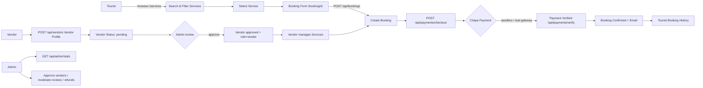
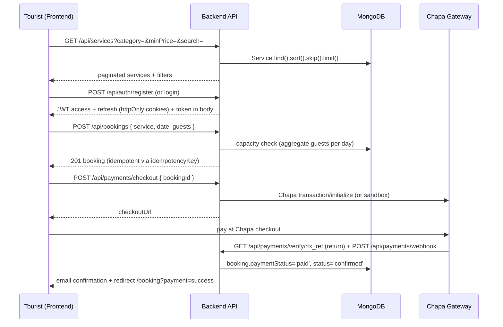
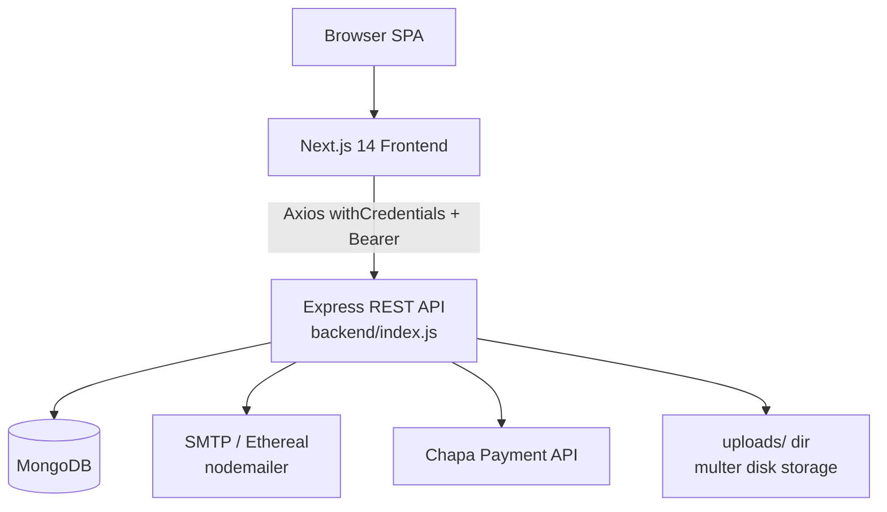
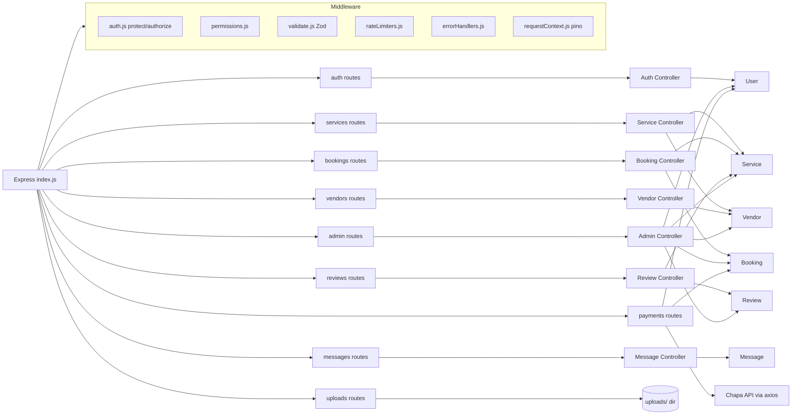
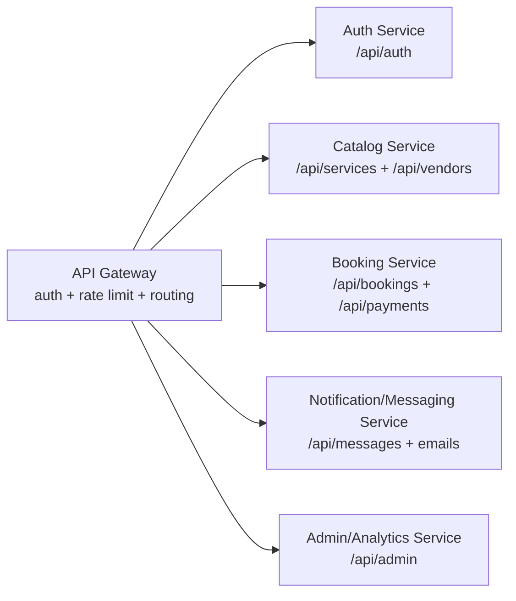

# Lake Tana Tourism Management System (LTTMS)

> Technical documentation generated directly from the source code of this repository.
> Every statement below is derived from the actual files in this repo. Anything that could
> not be found in the codebase is explicitly marked **NOT FOUND IN CODEBASE**.

**Repository:** `desalegnkasayemuluyekasaye-tech/LTTMS`
**Latest commits:** `fd76d92 more secure`, `aceba63 fix error`, `3b4f8c9 update admin page`, `82b3959 more structure the page`

---

## Table of Contents

1. [Project Overview](#1-project-overview)
2. [System Architecture](#2-system-architecture)
3. [Technology Stack](#3-technology-stack)
4. [Repository Structure](#4-repository-structure)
5. [Backend Documentation](#5-backend-documentation)
6. [API Documentation](#6-api-documentation)
7. [Database Documentation](#7-database-documentation)
8. [Authentication & Authorization](#8-authentication--authorization)
9. [Frontend Documentation](#9-frontend-documentation)
10. [UI Module Documentation](#10-ui-module-documentation)
11. [Package Analysis](#11-package-analysis)
12. [Docker Documentation](#12-docker-documentation)
13. [Swagger / OpenAPI Documentation](#13-swagger--openapi-documentation)
14. [Environment Variables](#14-environment-variables)
15. [Deployment Documentation](#15-deployment-documentation)
16. [Testing Documentation](#16-testing-documentation)
17. [Security Review](#17-security-review)
18. [Current Project Status](#18-current-project-status)
19. [Developer Setup Guide](#19-developer-setup-guide)
20. [Future Roadmap](#20-future-roadmap)

---

# 1. Project Overview

## Problem This Platform Solves

The **Lake Tana Tourism Management System (LTTMS)** is a full-stack tourism marketplace
for the Lake Tana region in Bahir Dar, Ethiopia. It connects **tourists** with local
**vendors** (boat operators, eco-lodges, restaurants, guides, monastery tour operators) so
they can discover, book, and pay for eco-tourism experiences, while giving platform
**administrators** the tools to verify vendors, moderate content, and monitor revenue.

The platform's stated purpose (from `frontend/README.md` and `PROJECT-OVERVIEW.md`) is a
"booking marketplace for Lake Tana tourism services" with a strong eco-tourism / sustainability
brand identity ("Every booking plants a tree", eco-certification badges, carbon footprint tools).

## Business Goals

* Provide a single marketplace to **discover and book** tourism services around Lake Tana.
* Promote **eco-certified / sustainable** travel (eco badges, carbon calculator, eco-score UI).
* Let local vendors **list and manage services** and receive **bookings**.
* Let administrators **verify vendors**, **moderate reviews**, **monitor transactions/commissions**,
  and **generate reports**.
* Support local payment via the **Chapa payment gateway** (ETH-based payment provider) with a built-in sandbox.

## Target Users & Main Actors

| Actor | Role value | What the code lets them do |
|-------|-----------|------------------------------|
| **Tourist** | `tourist` | Register, verify email, log in (incl. 2FA), browse services, filter/sort/search, create bookings, view own bookings, request refunds (UI only), leave reviews (API), message vendors (API). |
| **Vendor** | `vendor` | Register, create a vendor profile, create/update/delete services (API), update booking status (API), manage bookings (vendor dashboard UI — partially mock). |
| **Administrator** | `admin` | Full admin API: approve/reject/suspend vendors, toggle eco badges, manage users/roles, override bookings, approve refunds, view analytics/transactions/commission, moderate reviews, send announcements, export reports. |

## Core Workflows



**Actual end-to-end booking flow (from code):**



> **Note:** The full payment flow exists in the backend, but the frontend booking page
> (`pages/booking/[id].tsx`) only calls `POST /api/bookings` and does **not** yet call
> `/api/payments/checkout` (see [Current Project Status](#18-current-project-status)).

---

# 2. System Architecture

## Architecture Overview

This is a **two-tier monolith** application (NOT a microservice architecture):

```
┌─────────────────────────────┐        ┌──────────────────────────────────────────────┐
│         Browser             │        │                Backend (Express)             │
│                             │  HTTP   │                                              │
│  Next.js 14 (Pages Router)  │◄───────►│  /api/auth /api/services /api/bookings      │
│  React 18 + TS + Tailwind   │  Axios  │  /api/vendors /api/reviews /api/messages    │
│  Client-side rendering only  │  CORS   │  /api/payments /api/uploads /api/admin      │
└─────────────┬───────────────┘         │         │              │        │            │
              │                         │  middleware chain:     │        │            │
              │  (JWT in httpOnly      │  helmet · cors · pino  │        │            │
              │   cookies + Bearer     │  rate-limit · cookie   │        │            │
              │   token in localStorage│  parser · JSON 100kb   │        │            │
              │   · next/image assets) │                        │        │            │
              │                         └─────────┬──────────────┴──────┬─┴────────────┘
              │                                   │                     │
              │              ┌────────────────────┴──────┐      ┌───────┴────────┐
              │              │  MongoDB (Mongoose ODM)   │      │ Chapa Payment  │
              │              │  collections: users,      │◄────►│ Gateway (HTTP) │
              │              │  vendors, services,       │      │ (sandbox mode  │
              │              │  bookings, reviews,       │      │  if no key)    │
              │              │  messages                 │      └────────────────┘
              └──────────────┴───────────────────────────┘
```

* **Frontend** — Next.js 14 app under `frontend/`. Uses the **Pages Router**, renders
  everything **client-side** (no `getServerSideProps`/`getStaticProps` anywhere). Communicates
  with the backend through a single shared Axios instance (`frontend/utils/api.js`).
* **Backend** — a single Express.js service under `backend/`. REST API, route → controller →
  Mongoose model layering, plus Zod validation middleware and JWT auth middleware.
* **API Gateway / load balancer** — **NOT FOUND IN CODEBASE**. No gateway (e.g., Nginx, Traefik,
  Kong) exists. The frontend talks directly to the Express app. CORS is configured via the
  `FRONTEND_ORIGIN` env var in `backend/index.js`.
* **Database** — MongoDB accessed via Mongoose (ODM). 6 collections. No SQL database.
* **Authentication** — `jsonwebtoken` (JWT access + refresh), `bcryptjs` password hashing,
  `otplib` for TOTP-based 2FA delivered by email, in-memory token blacklist, account lockout.
* **Notification Service** — **not a separate service**. `nodemailer` (SMTP) in `backend/utils/email.js`
  sends email verification, password reset, 2FA codes, booking/payment confirmations, and vendor
  approval/rejection emails. In development without SMTP credentials it falls back to an
  **Ethereal test account**.
* **Payment Service** — **not a separate service**. Chapa integration lives inside
  `backend/routes/payments.js`: initialize checkout, verify transaction, and a webhook endpoint.
  Without a real secret key it runs in **sandbox mode** (simulated success).



---

# 3. Technology Stack

| Layer | Technology | Version (from lockfile/package.json) | Purpose |
|-------|-----------|--------------------------------------|---------|
| Frontend framework | Next.js (Pages Router) | `14.2.21` | SSR-capable React framework (used client-side here) |
| Frontend UI | React / React DOM | `^18.2.0` | Component library |
| Frontend language | TypeScript | `^5.3.0` | Type-safe frontend |
| Frontend styling | Tailwind CSS | `^3.3.6` | Utility-first styling (theme: primary `#0EA5E9`, secondary `#10B981`) |
| Frontend state (server) | @tanstack/react-query | `^5.100.9` | Server-state library (installed — see usage note below) |
| Frontend HTTP | axios | `^1.16.0` | API client + interceptors |
| Frontend animation | framer-motion | `^12.40.0` | Page transitions / animations |
| Frontend icons | react-icons | `^4.12.0` | Icon set |
| Backend framework | Express | `^4.19.2` | REST API |
| Database | MongoDB (Mongoose ODM) | `^8.3.4` | NoSQL data storage |
| Validation | Zod | `^4.4.3` | Request body/query/params schemas |
| Auth | jsonwebtoken + bcryptjs | `^9.0.2` / `^2.4.3` | JWT + password hashing |
| 2FA | otplib | `^13.4.0` | TOTP generation/verification |
| Security headers | helmet | `^8.1.0` | HTTP header hardening |
| CORS | cors | `^2.8.5` | Cross-origin rules |
| Cookies | cookie-parser | `^1.4.7` | Read httpOnly cookies |
| Rate limiting | express-rate-limit | `^8.5.0` | Brute-force protection |
| File uploads | multer | `^2.1.1` | Image uploads (5 MB, images only) |
| Email | nodemailer | `^8.0.7` | Transactional email |
| Caching | node-cache | `^5.1.2` | In-memory service list + idempotency cache |
| Logging | pino + pino-http | `^10.3.1` / `^11.0.0` | Structured JSON logging |
| Payment | Chapa REST API (axios) | — | ETH payment gateway (sandbox fallback) |
| Dev orchestration | concurrently | `^8.2.2` | Run frontend + backend together |
| Backend dev runner | nodemon | `^3.1.0` | Auto-restart on file change |
| Backend testing | node:test + supertest | supertest `^7.2.2` | API integration tests (runs via `node --test`) |
| Backend testing (declared) | jest | `^30.3.0` | Declared in devDependencies + `jest.config.js` exists, but the `test` script uses Node's built-in runner |
| CI/CD | GitHub Actions | — | `.github/workflows/ci.yml` |
| Deployment | Render.com blueprint | — | `render.yaml` |

> **Package versions** are read from `package.json`/`package-lock.json`. Exact locked versions are
> in `package-lock.json` at repo root, `backend/package-lock.json`, `frontend/package-lock.json`.

---

# 4. Repository Structure

```
LTTMS/
├── package.json                     # Root workspace: orchestration scripts + concurrently
├── package-lock.json                # Root lockfile
├── PROJECT-OVERVIEW.md              # High-level project overview document
├── README.md                        # This document
├── render.yaml                      # Render.com deployment blueprint (backend + frontend)
├── .gitignore
├── .github/
│   └── workflows/
│       └── ci.yml                   # CI: backend tests + frontend lint & build (Node 20)
│
├── frontend/                        # Next.js 14 (Pages Router) application
│   ├── package.json
│   ├── .env.example                 # NEXT_PUBLIC_API_BASE_URL
│   ├── next.config.js               # reactStrictMode + headers for /sw.js, /manifest.json
│   ├── tailwind.config.js           # Theme (primary #0EA5E9, secondary #10B981) + keyframes
│   ├── postcss.config.js            # tailwindcss + autoprefixer
│   ├── tsconfig.json / next-env.d.ts
│   ├── .eslintrc.json               # next/core-web-vitals
│   ├── pages/                       # File-based routes (ALL client-rendered)
│   │   ├── _app.tsx                 # Providers: Language > Auth > Toast > ErrorBoundary > Layout
│   │   ├── index.tsx                # Home / landing
│   │   ├── services.tsx             # Service browsing + filters (real API)
│   │   ├── booking.tsx              # "My bookings" dashboard (real API + mock fallbacks)
│   │   ├── booking/[id].tsx         # Single-service booking form
│   │   ├── reviews.tsx              # Reviews page (100% mock data)
│   │   ├── vendors.tsx              # Vendor directory (real API)
│   │   ├── eco-tourism.tsx          # Eco-tourism hub (100% static/mock)
│   │   ├── about.tsx                # About Lake Tana (static content)
│   │   ├── history.tsx              # Lake Tana history timeline (static content)
│   │   ├── contact.tsx              # Contact form (client-only, no API)
│   │   ├── login.tsx                # Login (incl. 2FA step)
│   │   ├── register.tsx             # Registration (tourist/vendor toggle)
│   │   ├── forgot-password.tsx      # Password reset request
│   │   ├── reset-password/[token].tsx
│   │   ├── verify-email/[token].tsx
│   │   ├── 404.tsx                  # Custom 404
│   │   ├── admin/
│   │   │   └── dashboard.tsx        # Admin panel (real admin API + mock fallbacks)
│   │   ├── vendor/
│   │   │   ├── login.tsx            # Redirects to /login
│   │   │   ├── register.tsx         # Redirects to /register
│   │   │   └── dashboard.tsx        # Vendor panel (partially real API, mostly mock)
│   │   └── tourist/                 # NOT FOUND IN CODEBASE (empty — referenced in docs only)
│   ├── components/                  # Reusable UI components
│   │   ├── Layout.tsx               # Auth-aware shell (route guarding) + page transitions
│   │   ├── Navbar.tsx               # Logged-in nav (role badge, dashboard link, i18n)
│   │   ├── PublicNavbar.tsx         # Guest nav (i18n)
│   │   ├── Footer.tsx               # Site footer
│   │   ├── PageTransition.tsx       # Framer Motion wrapper
│   │   ├── Chat.tsx                 # Messages widget (polls /api/messages every 10s)
│   │   └── ErrorBoundary.tsx        # React error boundary
│   ├── context/
│   │   ├── AuthContext.tsx          # Auth state, token in localStorage, /auth/me bootstrap
│   │   ├── LanguageContext.tsx      # i18n (en/am) via dynamic JSON import
│   │   └── ToastContext.tsx         # Toast notifications
│   ├── data/
│   │   └── lakeTanaHistory.ts       # Static history timeline + sources
│   ├── locales/
│   │   ├── en.json                  # English translations
│   │   └── am.json                  # Amharic translations
│   ├── utils/
│   │   └── api.js                   # Axios instance + auth/401 interceptors
│   ├── styles/
│   │   └── globals.css              # Tailwind + global styles
│   ├── public/
│   │   ├── manifest.json            # PWA manifest
│   │   ├── sw.js                    # Service worker (offline cache 'laketana-v1')
│   │   ├── icons/                   # PWA icons (192/512)
│   │   └── images/                  # Site images
│   └── IMAGES-GUIDE.md              # Image usage guide
│
└── backend/                         # Express REST API (single service)
    ├── package.json
    ├── index.js                     # App entry: middleware, routes, /health, /metrics
    ├── seed.js                      # Database seeder (admin, vendor, 3 services)
    ├── jest.config.js               # Legacy Jest config (test script uses node --test)
    ├── .env.example                 # Env var template
    ├── routes/                      # Route definitions (thin → controllers)
    │   ├── auth.js                  # /api/auth/*
    │   ├── services.js              # /api/services/*
    │   ├── bookings.js              # /api/bookings/*
    │   ├── vendors.js               # /api/vendors/*
    │   ├── reviews.js               # /api/reviews/*
    │   ├── messages.js              # /api/messages/*
    │   ├── admin.js                 # /api/admin/*
    │   ├── uploads.js               # /api/uploads/*
    │   └── payments.js              # /api/payments/* (Chapa)
    ├── controllers/                 # Business logic
    │   ├── authController.js        # register/login/refresh/2FA/email-verify/password
    │   ├── serviceController.js     # CRUD + caching + pagination + filters
    │   ├── bookingController.js     # create/get + capacity check + idempotency
    │   ├── vendorController.js      # register/get vendors
    │   ├── reviewController.js      # add/get/delete + avg rating update
    │   ├── messageController.js     # send/get/mark-as-read
    │   └── adminController.js       # vendors/users/bookings/transactions/analytics/etc.
    ├── models/                      # Mongoose schemas
    │   ├── User.js  Vendor.js  Service.js
    │   ├── Booking.js  Review.js  Message.js
    ├── middleware/
    │   ├── auth.js                  # JWT verify, role authorize, token blacklist
    │   ├── permissions.js           # Fine-grained permission map (requirePermission)
    │   ├── validate.js              # Zod schema runner
    │   ├── errorHandlers.js         # 404 + global error handler (requestId)
    │   ├── rateLimiters.js          # authLimiter (20/15min), publicLimiter (120/min)
    │   └── requestContext.js        # requestId + pino-http logger
    ├── validation/                  # Zod schemas
    │   ├── authSchemas.js  serviceSchemas.js  bookingSchemas.js
    │   ├── reviewSchemas.js  messageSchemas.js
    ├── utils/
    │   ├── logger.js                # Pino logger (LOG_LEVEL)
    │   └── email.js                 # Nodemailer transporter + HTML templates
    ├── tests/
    │   └── api.test.js              # Integration tests (node:test + supertest)
    └── uploads/                     # Multer upload destination (gitignored, .gitkeep)
```

**Directory purposes:**

| Directory | Purpose |
|-----------|---------|
| `frontend/` | Public-facing Next.js web app (tourist + vendor + admin UIs) |
| `frontend/pages/` | File-based routes; nested folders create URL structure |
| `frontend/components/` | Reusable UI shells and widgets |
| `frontend/context/` | React Context providers for global state (auth, i18n, toasts) |
| `frontend/locales/` | JSON translation files for English and Amharic |
| `backend/` | Single Express REST API service |
| `backend/routes/` | HTTP route wiring (delegates to controllers) |
| `backend/controllers/` | Request handling / business logic |
| `backend/models/` | Mongoose schemas & indexes |
| `backend/middleware/` | Cross-cutting concerns (auth, validation, logging, rate limit) |
| `backend/validation/` | Zod schemas for request validation |
| `backend/utils/` | Logger + email transport |
| `backend/tests/` | API integration tests |
| `backend/uploads/` | Uploaded image storage (served at `/uploads`) |
| `.github/workflows/` | CI pipeline |
| `render.yaml` | Render.com infrastructure-as-code |

---

# 5. Backend Documentation

The backend is a **single Express service** (not microservices). There is one entry point,
`backend/index.js`, which mounts 9 route groups under `/api`.

## 5.1 Service Overview

| Attribute | Value |
|-----------|-------|
| Name | `lttms-backend` (`backend/package.json`) |
| Entry point | `backend/index.js` |
| Port | `process.env.PORT || 5000` |
| Runtime | Node.js (CI uses Node 20) |
| Database | MongoDB (Mongoose) via `MONGODB_URI` |
| Default frontend origin | `http://localhost:3000` (from `FRONTEND_ORIGIN`) |

### Purpose

Expose a REST API for authentication, services, bookings, vendors, reviews, messages,
payments (Chapa), uploads, and admin operations.

### Responsibilities

* Issue JWT access + refresh tokens; enforce auth via middleware.
* Manage users (register, login, email verify, password reset/change, 2FA).
* CRUD tourism services with filtering, sorting, pagination, and text search.
* Create bookings with **per-day capacity checks** and **idempotency keys**.
* Manage vendor profiles and approvals.
* Reviews with automatic average-rating recomputation on the service.
* One-to-one messaging between users.
* Chapa payment initialization, verification, and webhook handling.
* Image uploads (5 MB max, image mimetypes only).
* Admin-only operations: vendor verification, user/role management, booking override,
  refunds, transactions/commission, analytics, review moderation, announcements, CSV export.

### Dependencies

| Dependency | Purpose |
|------------|---------|
| `express` | HTTP server & routing |
| `mongoose` | MongoDB ODM |
| `zod` | Request validation |
| `jsonwebtoken` | JWT signing/verification |
| `bcryptjs` | Password hashing |
| `otplib` | TOTP 2FA |
| `nodemailer` | Transactional email |
| `multer` | File uploads |
| `express-rate-limit` | Rate limiting |
| `helmet` | Security headers |
| `cors` | Cross-origin config |
| `cookie-parser` | Cookie reading |
| `node-cache` | In-memory caches |
| `pino` / `pino-http` | Structured logging |
| `axios` | Chapa gateway HTTP client |
| `dotenv` | `.env` loading |

### Database Access

All access via Mongoose models in `backend/models/`. See [Database Documentation](#7-database-documentation).

### Ports

* Backend listens on `PORT` (default `5000`).
* Frontend expects the API at `NEXT_PUBLIC_API_URL || NEXT_PUBLIC_API_BASE_URL || http://localhost:5000/api`.
* Static uploads served at `/uploads`.

### Environment Variables

See [Environment Variables](#14-environment-variables).

### Docker Configuration

**NOT FOUND IN CODEBASE.** No `Dockerfile`, no `docker-compose*`, no `.dockerignore` exist anywhere in the repository. The backend is deployed on Render as a plain Node web service (`render.yaml`).

### Swagger Documentation

**NOT FOUND IN CODEBASE.** No Swagger/OpenAPI files or `swagger-ui-express`/`swagger-jsdoc` dependencies exist. Routes are documented inline as `// @desc` comments in controllers.

### Health Endpoints

| Endpoint | Auth | Description |
|----------|------|-------------|
| `GET /` | none | Text: `LTTMS API is running...` |
| `GET /health` | none | `{ success, status: ok|degraded, dependencies: { mongodb: up|down }, uptime, timestamp }` |
| `GET /metrics` | none | `{ success, metrics: { uptime, memoryRss, dbReadyState } }` |

### Authentication Requirements

| Route group | Protection |
|-------------|------------|
| `/api/auth/register`, `/login`, `/refresh`, `/verify-email/:token`, `/forgot-password`, `/reset-password/:token`, `/verify-2fa` | Public (rate-limited with `authLimiter`) |
| `/api/auth/logout`, `/me`, `/change-password`, `/enable-2fa`, `/disable-2fa` | `protect` |
| `/api/services` | Public read; vendor/admin for write |
| `/api/bookings` | `protect` + role-based (admin GET all; tourist POST; vendor/admin PUT) |
| `/api/vendors` | Public read; `protect` for creating a profile |
| `/api/reviews` | Public read; `protect` tourist/admin for write |
| `/api/messages` | `protect` (all routes) |
| `/api/admin/*` | `protect` + `authorize('admin')` |
| `/api/uploads/image` | `protect` + vendor/admin |
| `/api/payments/checkout`, `/status/:bookingId` | `protect` |
| `/api/payments/verify/:tx_ref`, `/webhook` | Public (webhook signature-checked) |

## 5.2 Service Dependency Diagram



---

# 6. API Documentation

All routes discovered from `backend/routes/*.js`. Base path: `/api`. Response envelope is
`{ success: boolean, message?, data? }` for errors, or `{ success, data|count|total|page|... }`.

## 6.1 Authentication — `/api/auth`

| Method | Endpoint | Auth | Request Body | Response | Errors |
|--------|----------|------|--------------|----------|--------|
| POST | `/api/auth/register` | public (authLimiter) | `{ name, email, password, phone?, role?: 'tourist'|'vendor' }` | `201 { success, token, user }` | 400 validation, 409 duplicate email |
| POST | `/api/auth/login` | public (authLimiter) | `{ email, password, rememberMe? }` | `200 { success, token, user }` or `{ requiresTwoFactor: true, twoFactorToken }` | 401 invalid creds, 423 locked, 429 rate limit |
| POST | `/api/auth/refresh` | public (uses `refreshToken` cookie) | — | `200 { success, token, user }` | 401 no/invalid refresh token |
| GET | `/api/auth/verify-email/:token` | public | — | `200 { success, message }` | 400 invalid/expired token |
| POST | `/api/auth/forgot-password` | public (authLimiter) | `{ email }` | `200 { success, message }` (always same message to prevent enumeration) | 400 validation |
| PUT | `/api/auth/reset-password/:token` | public (authLimiter) | `{ password }` | `200 { success, message }` | 400 invalid/expired token |
| POST | `/api/auth/verify-2fa` | public (authLimiter) | `{ twoFactorToken, code }` | `200 { success, token, user }` | 401 invalid token/code |
| POST | `/api/auth/logout` | `protect` | — | `200 { success, message }` | 401 |
| GET | `/api/auth/me` | `protect` | — | `200 { success, data: { id, name, email, phone, role, isVerified, twoFactorEnabled, lastLogin, createdAt } }` | 401 |
| PUT | `/api/auth/change-password` | `protect` | `{ currentPassword, newPassword }` | `200 { success, message }` | 401 wrong current password |
| POST | `/api/auth/enable-2fa` | `protect` | — | `200 { success, secret, otpauth }` | 400 |
| POST | `/api/auth/disable-2fa` | `protect` | — | `200 { success, message }` | 400 |

Example — `POST /api/auth/login`:
```jsonc
// Request
{ "email": "tourist@example.com", "password": "secret123", "rememberMe": false }

// Response 200
{
  "success": true,
  "token": "<JWT>",
  "user": { "id": "...", "name": "...", "email": "...", "role": "tourist",
            "isVerified": false, "twoFactorEnabled": false }
}
// Cookies also set: accessToken (15m), refreshToken (30d) — httpOnly, sameSite=strict
```

## 6.2 Services — `/api/services`

| Method | Endpoint | Auth | Description |
|--------|----------|------|-------------|
| GET | `/api/services` | public | List with query params: `page`, `limit` (≤50), `category`, `sortBy` (`featured|price-low|price-high|rating`), `ecoFriendly` (`true/false`), `minPrice`, `maxPrice`, `search`. Returns paginated list + `pagination` flags. Cached 60 s. |
| GET | `/api/services/:id` | public | Single service, populated vendor |
| POST | `/api/services` | `protect` + `authorize('vendor','admin')` | Body: `{ title, description, price, category, duration?, location?, dailyCapacity?, ecoFriendly?, images?, highlights? }`. Vendor profile required (401 otherwise). |
| PUT | `/api/services/:id` | `protect` + `authorize('vendor','admin')` | Partial update; only owning vendor (or admin). |
| DELETE | `/api/services/:id` | `protect` + `authorize('vendor','admin')` | Delete; only owning vendor (or admin). |

Example — `POST /api/services` (vendor):
```jsonc
// Request
{ "title": "Sunset Boat Tour", "description": "2-hour sunset cruise ...",
  "price": 50, "category": "boat", "dailyCapacity": 12, "ecoFriendly": true }

// Response 201
{ "success": true, "data": { "_id": "...", "vendor": "<vendorId>", "title": "...",
  "category": "boat", "price": 50, "dailyCapacity": 12, "ecoFriendly": true,
  "availability": true, "rating": 0, "images": [], "createdAt": "..." } }
```

## 6.3 Bookings — `/api/bookings`

| Method | Endpoint | Auth | Description |
|--------|----------|------|-------------|
| GET | `/api/bookings` | `protect` + `authorize('admin')` | All bookings, populated user+service |
| GET | `/api/bookings/user` | `protect` + `authorize('tourist','admin')` | Current user's bookings |
| POST | `/api/bookings` | `protect` + `authorize('tourist','admin')` + `requirePermission('bookings:create:own')` | `{ service, date, guests?, idempotencyKey? }`. Price computed server-side. Capacity check per day. |
| PUT | `/api/bookings/:id` | `protect` + `authorize('vendor','admin')` | Only `status`/`paymentStatus`/`transactionId`; vendor must own the service. |

Example — `POST /api/bookings`:
```jsonc
// Request
{ "service": "66f...", "date": "2026-08-15", "guests": 2, "idempotencyKey": "req-abc-1234" }

// Response 201
{ "success": true, "data": { "_id": "...", "user": "...", "service": "...",
  "date": "...", "guests": 2, "totalAmount": 100, "status": "pending",
  "paymentStatus": "unpaid", "paymentMethod": "chapa" } }
// 409 if day capacity exceeded; 200 idempotent replay on duplicate key
```

## 6.4 Vendors — `/api/vendors`

| Method | Endpoint | Auth | Description |
|--------|----------|------|-------------|
| GET | `/api/vendors` | public | Approved vendors, populated user (name/email) |
| GET | `/api/vendors/:id` | public | Single vendor (any status) |
| POST | `/api/vendors` | `protect` | Create vendor profile for current user (409 if exists). Body: `{ businessName, location, ecoCertification?, description?, phone?, licenseFile? }` |

## 6.5 Reviews — `/api/reviews`

| Method | Endpoint | Auth | Description |
|--------|----------|------|-------------|
| GET | `/api/reviews/service/:serviceId` | public | Reviews for a service |
| POST | `/api/reviews` | `protect` + `authorize('tourist','admin')` | `{ service, rating (1-5), comment }`; recomputes service avg rating |
| DELETE | `/api/reviews/:id` | `protect` + `authorize('tourist','admin')` | Owner or admin only |

## 6.6 Messages — `/api/messages`

| Method | Endpoint | Auth | Description |
|--------|----------|------|-------------|
| GET | `/api/messages` | `protect` | Messages where user is sender or receiver |
| POST | `/api/messages` | `protect` | `{ receiver, content }` |
| PUT | `/api/messages/:id/read` | `protect` | Mark as read (receiver only) |

## 6.7 Admin — `/api/admin` (all routes: `protect` + `authorize('admin')`)

| Method | Endpoint | Description |
|--------|----------|-------------|
| GET | `/api/admin/stats` | Platform counters + totalRevenue |
| GET | `/api/admin/vendors` | List vendors (`?status=&page=&limit=`) |
| GET | `/api/admin/vendors/:id` | Vendor detail + services + bookings + revenue + avg rating |
| PUT | `/api/admin/vendors/:id/status` | Set `approved/rejected/pending/suspended/blacklisted`; syncs user role; emails vendor |
| PUT | `/api/admin/vendors/:id/eco-badge` | Toggle `ecoCertification` |
| GET | `/api/admin/users` | List users (`?role=&page=&limit=`) |
| PUT | `/api/admin/users/:id/status` | Set `isActive` |
| PUT | `/api/admin/users/:id/role` | Assign role |
| GET | `/api/admin/bookings` | List bookings (`?status=&page=&limit=`) |
| PUT | `/api/admin/bookings/:id/override` | Set `status` + `adminNote` |
| GET | `/api/admin/reports/bookings` | Booking report `?period=daily|weekly|monthly` |
| GET | `/api/admin/transactions` | Paid/non-unpaid bookings → transactions with 5% commission |
| GET | `/api/admin/reports/commission` | Aggregate revenue + 5% commission |
| PUT | `/api/admin/bookings/:id/refund` | Set `paymentStatus=refunded`, `status=cancelled` |
| GET | `/api/admin/eco-compliance` | Vendors + ecoCertification/status |
| GET | `/api/admin/analytics` | Counts, revenue, 30-day trend, top vendors, bookings by category |
| GET | `/api/admin/reports/export` | CSV export of all bookings (`?type=csv`) |
| GET | `/api/admin/reviews` | All reviews, populated |
| DELETE | `/api/admin/reviews/:id` | Moderate: body `{ action: 'remove' }` (flag is no-op) |
| POST | `/api/admin/announcements` | `{ title, message, target? }` — logs only, **no persistence/delivery implemented** |
| GET | `/api/admin/audit-logs` | Returns `{ data: [], total: 0 }` — **stub, not implemented** |

## 6.8 Uploads — `/api/uploads`

| Method | Endpoint | Auth | Description |
|--------|----------|------|-------------|
| POST | `/api/uploads/image` | `protect` + `authorize('vendor','admin')` | Multipart `image` (≤5 MB, image/*). Returns `{ filename, url: '/uploads/<file>' }`. |

## 6.9 Payments — `/api/payments`

| Method | Endpoint | Auth | Description |
|--------|----------|------|-------------|
| POST | `/api/payments/checkout` | `protect` | `{ bookingId }` → initializes Chapa (or sandbox). Returns `{ checkoutUrl, txRef, amount, currency }`. |
| GET | `/api/payments/verify/:tx_ref` | public | Verifies with Chapa; on success sets `paid`/`confirmed` + sends email |
| POST | `/api/payments/webhook` | public (HMAC `x-chapa-signature`) | Chapa webhook; confirms on `charge.completed` |
| GET | `/api/payments/status/:bookingId` | `protect` | Booking owner/admin payment status |

---

# 7. Database Documentation

Database: **MongoDB** with Mongoose. There is no SQL schema, no Prisma schema, and no migration
files. **Prisma/PostgreSQL: NOT FOUND IN CODEBASE.** Six collections:

```mermaid
erDiagram
    USER ||--o{ BOOKING : "makes"
    USER ||--o{ REVIEW : "writes"
    USER ||--o{ MESSAGE : "sends"
    USER ||--o{ MESSAGE : "receives"
    USER ||--o{ VENDOR : "owns (user)"
    VENDOR ||--o{ SERVICE : "lists"
    SERVICE ||--o{ BOOKING : "receives"
    SERVICE ||--o{ REVIEW : "gets"

    USER {
        ObjectId _id PK
        string name
        string email UK
        string phone
        string password (bcrypt, select:false)
        string role "tourist|vendor|admin"
        boolean isVerified
        string verificationToken
        date verificationTokenExpire
        string resetPasswordToken
        date resetPasswordExpire
        boolean twoFactorEnabled
        string twoFactorSecret
        boolean isActive
        number loginAttempts
        date lockUntil
        date lastLogin
        date createdAt
    }
    VENDOR {
        ObjectId _id PK
        ObjectId user FK
        string businessName UK
        string location
        boolean ecoCertification
        string description
        string phone
        string status "pending|approved|rejected|suspended|blacklisted"
        string licenseFile
        string rejectionReason
        date approvedAt
        date createdAt
    }
    SERVICE {
        ObjectId _id PK
        ObjectId vendor FK
        string title
        string category "tour|hotel|food|monastery|boat|waterfall"
        string description
        number price
        number dailyCapacity default 20
        boolean availability default true
        string[] images
        number rating default 0
        boolean ecoFriendly default false
        date createdAt
    }
    BOOKING {
        ObjectId _id PK
        ObjectId user FK
        ObjectId service FK
        date date
        number guests default 1
        number totalAmount
        string status "pending|confirmed|completed|cancelled"
        string paymentStatus "unpaid|paid|refunded|processing|failed"
        string paymentMethod "telebirr|cbe|amole|paypal|stripe|chapa"
        string transactionId
        date createdAt
    }
    REVIEW {
        ObjectId _id PK
        ObjectId user FK
        ObjectId service FK
        number rating "1..5"
        string comment
        date createdAt
    }
    MESSAGE {
        ObjectId _id PK
        ObjectId sender FK
        ObjectId receiver FK
        string content
        boolean isRead default false
        date createdAt
    }
```

## Model-by-model

### User (`models/User.js`)
* **Fields / types**: `name` (String, req), `email` (String, req, unique, lowercase, regex), `phone` (String), `password` (String, req, min 6, `select:false`), `role` (enum tourist/vendor/admin, default tourist), `isVerified` (Bool), `verificationToken`/`verificationTokenExpire`, `resetPasswordToken`/`resetPasswordExpire`, `twoFactorEnabled` (Bool), `twoFactorSecret`, `twoFactorCodeExpire`, `isActive` (Bool), `loginAttempts` (Number), `lockUntil` (Date), `lastLogin`, `createdAt`.
* **Indexes**: `{ lockUntil: 1 }` with `expireAfterSeconds: 0` (documents auto-removed once unlock time passes — note this would delete the user document, see Security Review).
* **Hooks/methods**: `pre('save')` bcrypt hash (cost 12); `matchPassword()`; `isLocked()`; `generateVerificationToken()` (SHA-256 hash, 24 h); `generateResetToken()` (SHA-256 hash, 1 h).
* **Relationships**: `User → Booking (user)`, `User → Review (user)`, `User → Message (sender/receiver)`, `User → Vendor (user)`.

### Vendor (`models/Vendor.js`)
* **Fields**: `user` (ObjectId ref User, req), `businessName` (String, req, unique), `location` (String, req), `ecoCertification` (Bool), `description`, `phone`, `status` (enum pending/approved/rejected/suspended/blacklisted, default pending), `licenseFile`, `rejectionReason`, `approvedAt`, `createdAt`.
* **Relationships**: `Vendor → User`, `Vendor → Service (vendor)`.

### Service (`models/Service.js`)
* **Fields**: `vendor` (ref Vendor, req), `title` (req, trim), `category` (enum tour/hotel/food/monastery/boat/waterfall, req), `description` (req), `price` (Number, req), `dailyCapacity` (default 20, min 1), `availability` (Bool default true), `images` [String], `rating` (default 0), `ecoFriendly` (Bool), `createdAt`.
* **Indexes**: text index on `{ title, description }`; compound `{ category: 1, ecoFriendly: 1, price: 1, rating: -1 }`.
* **Relationships**: `Service → Vendor`, `Service → Booking (service)`, `Service → Review (service)`.

### Booking (`models/Booking.js`)
* **Fields**: `user` (ref User, req), `service` (ref Service, req), `date` (Date, req), `guests` (default 1), `totalAmount` (req), `status` (pending/confirmed/completed/cancelled), `paymentStatus` (unpaid/paid/refunded/processing/failed), `paymentMethod` (telebirr/cbe/amole/paypal/stripe/chapa, default chapa), `transactionId`, `createdAt`.
* **Relationships**: `Booking → User`, `Booking → Service`. No compound unique index on user+service+date (idempotency handled via in-memory cache instead).

### Review (`models/Review.js`)
* **Fields**: `user` (ref User, req), `service` (ref Service, req), `rating` (Number, req, min 1 max 5), `comment` (req), `createdAt`.
* **Note**: no unique index preventing duplicate reviews per user+service.

### Message (`models/Message.js`)
* **Fields**: `sender` (ref User, req), `receiver` (ref User, req), `content` (req), `isRead` (default false), `createdAt`.

---

# 8. Authentication & Authorization

## JWT Flow

```mermaid
sequenceDiagram
    participant C as Client
    participant A as /api/auth
    participant M as protect middleware
    participant D as MongoDB

    C->>A: POST /auth/login {email, password}
    A->>D: findOne().select('+password'); bcrypt.compare
    A-->>C: 200 {token, user} + Set-Cookie accessToken & refreshToken (httpOnly, sameSite=strict)
    Note over C: token also stored in localStorage for Bearer header
    C->>M: GET /api/bookings/user (Bearer token OR accessToken cookie)
    M->>M: blacklist check → jwt.verify(token, JWT_SECRET)
    M->>D: User.findById(decoded.id); check isActive
    M-->>C: req.user set → route handler
    C->>A: POST /auth/refresh (refreshToken cookie)
    A->>A: jwt.verify(refresh, JWT_REFRESH_SECRET)
    A-->>C: new access + refresh tokens
    C->>A: POST /auth/logout
    A->>A: blacklistToken(access token) + clear cookies
```

### Details (from `authController.js` / `middleware/auth.js`)

* **Access token**: `jwt.sign({ id, role }, JWT_SECRET, { expiresIn: JWT_EXPIRES_IN || '15m' })` (7 d if `rememberMe`).
* **Refresh token**: `jwt.sign({ id, type: 'refresh' }, JWT_REFRESH_SECRET || JWT_SECRET, { expiresIn: JWT_REFRESH_EXPIRES_IN || '30d' })` (90 d if `rememberMe`).
* **Cookie options**: `httpOnly: true, secure: NODE_ENV==='production', sameSite: 'strict'`.
* **Token retrieval order**: `Authorization: Bearer <token>` header first, then `accessToken` cookie.
* **Token blacklist**: in-memory `Map` in `middleware/auth.js` (comment notes "use Redis in production"); cleanup every 15 min; can be disabled via `JWT_BLACKLIST_ENABLED=false`.

## Password Hashing

* `bcryptjs` with **salt rounds = 12** (`userSchema.pre('save')`, `bcrypt.genSalt(12)`).
* `password` field uses `select: false` so it is excluded from queries unless explicitly requested.

## Account Lockout

* `MAX_LOGIN_ATTEMPTS = 5`, `LOCK_DURATION = 30 min`.
* On 5 failed logins the account is locked (`loginAttempts >= 5` → `lockUntil`), returns **423**.
* Successful login resets attempts.

## 2FA (TOTP)

* `otplib` `authenticator`. Login with 2FA enabled returns a 10-min `twoFactorToken`; the code is **emailed** to the user (`/api/auth/verify-2fa` validates `authenticator.check(code, secret)`).
* Enable/disable via `/api/auth/enable-2fa`, `/api/auth/disable-2fa` (returns TOTP secret + `otpauth://` URI).

## RBAC

Two mechanisms:

1. **Role middleware** `authorize(...roles)` in `middleware/auth.js` — blocks by role enum.
2. **Permission map** `rolePermissions` in `middleware/permissions.js`:

| Permission | admin | vendor | tourist |
|------------|:-----:|:------:|:-------:|
| `bookings:read:any` | ✓ | | |
| `bookings:update:any` | ✓ | | |
| `bookings:create:own` | ✓ | | ✓ |
| `bookings:update:own` | | ✓ | |
| `services:manage:any` | ✓ | | |
| `services:manage:own` | | ✓ | |

`requirePermission` is currently applied to exactly one route: `POST /api/bookings` (`bookings:create:own`).

## Other Security Mechanisms

* `helmet()` security headers (all default).
* CORS allow-list from `FRONTEND_ORIGIN` (comma-separated), `credentials: true`.
* `express.json({ limit: '100kb' })`.
* Rate limiting: `authLimiter` = 20 req / 15 min on auth endpoints; `publicLimiter` = 120 req / min globally.
* Email verification required flag (`isVerified`) exists but is **not enforced** on login (see Status).
* `forgot-password` returns a uniform message to prevent user enumeration.
* Request IDs (`x-request-id`) via `requestContext.js`.
* Webhook HMAC check with `CHAPA_WEBHOOK_SECRET` (skipped if unset or `'replace-this'`).

---

# 9. Frontend Documentation

**Framework:** Next.js `14.2.21` **Pages Router** (not App Router). All pages are **client-rendered** — no `getServerSideProps`/`getStaticProps`/`getStaticPaths` exist anywhere. PWA-ready: `public/sw.js` service worker + `manifest.json`.

## Global Shell (`_app.tsx`)

Provider order: `LanguageProvider → AuthProvider → ToastProvider → ErrorBoundary → Layout → page`.

## Route Guarding (`components/Layout.tsx`)

* `PUBLIC_ROUTES = ['/', '/login', '/register', '/forgot-password', '/reset-password', '/verify-email', '/vendors', '/services']`.
* Unauthenticated users visiting non-public, non-dashboard routes are redirected to `/register`.
* Dashboard routes (`/admin`, `/vendor`) render without the public shell (no navbar/footer) but return `null` if not authenticated.
* **Important**: the guard only checks "isAuthenticated" from AuthContext (bootstrap via `GET /auth/me`). Role-based page access is implemented separately inside dashboards (admin checks `role==='admin'`; vendor dashboard only checks for *any* token — see Status).

## API Integration (`utils/api.js`)

* Base URL: `NEXT_PUBLIC_API_URL || NEXT_PUBLIC_API_BASE_URL || 'http://localhost:5000/api'`.
* `withCredentials: true`; request interceptor adds `Authorization: Bearer <localStorage.token>`.
* Response interceptor: on 401, clears `token`/`user` from localStorage and redirects to `/register` (unless already on `/`, `/register`, `/login`).

## State Management

* Global: React Context (`AuthContext`, `LanguageContext`, `ToastContext`).
* Server state: `@tanstack/react-query` is **installed but not used** in any page (verified — no `QueryClient`/`useQuery` imports). All data fetching is raw `useEffect` + axios.
* Local: `useState` throughout; `framer-motion` `AnimatePresence` for page transitions.

## i18n

* `LanguageContext` dynamically imports `locales/en.json` and `locales/am.json`; `t(key)` resolves nested keys (e.g. `nav.home`).
* Language switcher lives in `Navbar`/`PublicNavbar` (EN/አማ). Note: most page body copy is hardcoded English; translations mainly cover nav labels.

## Forms & Validation

* Registration (`register.tsx`, index page): client-side regex + password strength meter; backend Zod on top.
* Login: client validation + 2FA step.
* Booking: date/guest/terms validation; `POST /api/bookings`.
* Contact: fully client-side validation, **no API call**.
* Vendor/Admin dashboards: HTML `required` only; several forms are non-functional (see Status).

## Routing / Page Hierarchy

```mermaid
graph TD
    App[_app.tsx providers + Layout] --> Home["/ index.tsx"]
    App --> Services["/services.tsx"]
    App --> BookingList["/booking.tsx"]
    App --> BookingDetail["/booking/[id].tsx"]
    App --> Vendors["/vendors.tsx"]
    App --> Reviews["/reviews.tsx"]
    App --> Eco["/eco-tourism.tsx"]
    App --> About["/about.tsx"]
    App --> History["/history.tsx"]
    App --> Contact["/contact.tsx"]
    App --> Login["/login.tsx"]
    App --> Register["/register.tsx"]
    App --> Forgot["/forgot-password.tsx"]
    App --> Reset["/reset-password/[token].tsx"]
    App --> Verify["/verify-email/[token].tsx"]
    App --> Admin["/admin/dashboard.tsx"]
    App --> VendorLogin["/vendor/login.tsx → /login"]
    App --> VendorReg["/vendor/register.tsx → /register"]
    App --> VendorDash["/vendor/dashboard.tsx"]
    App --> NotFound["/404.tsx"]
```



---

# 10. UI Module Documentation

| Module | Pages | Purpose | Real API used | State | Permissions |
|--------|-------|---------|---------------|-------|-------------|
| **Home** | `/` | Landing: hero+search, featured destinations, why-us, eco services, sustainability, testimonials, stats, inline registration form | `POST /api/auth/register` | AuthContext, form state | Public |
| **Explore** | `/services`, `/booking/[id]` | Browse/filter/sort/search services (8/page); detail modal; booking form | `GET /api/services`, `GET /api/services/:id`, `POST /api/bookings` | useState; wishlist = in-memory Set (not persisted) | Public read; booking requires login |
| **Bookings** | `/booking` | "My bookings" dashboard: stat cards, tabs, calendar, detail/refund modals | `GET /api/bookings/user` | useState; token check | `tourist`/`admin` (token presence) |
| **Vendor Dashboard** | `/vendor/dashboard` | 10 tabs: Overview, Profile, Services, Bookings, Revenue, Eco-Compliance, Engagement, Analytics, Notifications, Settings | `GET /api/services`, `GET /api/bookings/user` (read-only; everything else mock) | useState | any valid token (no role check) |
| **Admin Dashboard** | `/admin/dashboard` | 9 tabs: Overview, Vendors, Users, Bookings, Payments, Eco-Compliance, Reviews, Notifications, Security | `GET /api/admin/{stats,vendors,users,bookings,transactions,reviews}`, `PUT /api/admin/vendors/:id/{status,eco-badge}`, `PUT /api/admin/bookings/:id/override`, `PUT /api/admin/reviews/:id/moderate`, `POST /api/admin/announcement` | useState; mock fallbacks | `admin` role (checked client-side) |
| **Reviews** | `/reviews` | Rating distribution, review cards, write-review modal | **None — 100% hardcoded `reviewsData`** | useState | Public |
| **Eco-Tourism** | `/eco-tourism` | 8 sections: badges, carbon tracker, community, green vendors, eco dashboard, volunteer/donate | **None — 100% static** | useState | Public |
| **Settings / Account** | `/login`, `/register`, `/forgot-password`, `/reset-password/[token]`, `/verify-email/[token]` | Auth flows incl. 2FA step, password strength, email verification | `POST /api/auth/*`, `GET /api/auth/verify-email/:token` | AuthContext + useState | Public |
| **Vendors Directory** | `/vendors` | Search/filter vendor cards | `GET /api/vendors` | useState | Public |
| **About / History / Contact** | `/about`, `/history`, `/contact` | Static editorial content + contact form | **None** (contact form is client-only) | useState (contact) | Public |

> **Admin dashboard endpoint mismatch:** the page calls `/admin/announcement` and
> `/admin/reviews/:id/moderate`, while the backend routes are `/admin/announcements` and
> `DELETE /admin/reviews/:id`. These calls would 404 / fail (see Status).

---

# 11. Package Analysis

## Root (`package.json`)
| Package | Type | Purpose |
|---------|------|---------|
| concurrently `^8.2.2` | dev | Run frontend and backend dev servers from one command (`npm run dev`) |

## Backend (`backend/package.json`)
| Package | Version | Type | Purpose |
|---------|---------|------|---------|
| axios | `^1.16.1` | prod | HTTP client for Chapa payment gateway |
| bcryptjs | `^2.4.3` | prod | Password hashing |
| cookie-parser | `^1.4.7` | prod | Parse httpOnly auth cookies |
| cors | `^2.8.5` | prod | CORS allow-list + credentials |
| dotenv | `^16.4.5` | prod | Load `.env` |
| express | `^4.19.2` | prod | Web framework / routing |
| express-rate-limit | `^8.5.0` | prod | Brute-force / abuse limiting |
| helmet | `^8.1.0` | prod | Security HTTP headers |
| jsonwebtoken | `^9.0.2` | prod | JWT access/refresh/2FA tokens |
| mongoose | `^8.3.4` | prod | MongoDB ODM |
| multer | `^2.1.1` | prod | Image uploads |
| node-cache | `^5.1.2` | prod | In-memory service + idempotency caches |
| nodemailer | `^8.0.7` | prod | Transactional email (SMTP/Ethereal) |
| otplib | `^13.4.0` | prod | TOTP 2FA |
| pino | `^10.3.1` | prod | Structured JSON logging |
| pino-http | `^11.0.0` | prod | HTTP request logging |
| zod | `^4.4.3` | prod | Request validation schemas |
| jest | `^30.3.0` | dev | Declared test framework (config exists, test script uses node:test) |
| nodemon | `^3.1.0` | dev | Dev auto-restart |
| supertest | `^7.2.2` | dev | HTTP assertions in tests |

## Frontend (`frontend/package.json`)
| Package | Version | Type | Purpose |
|---------|---------|------|---------|
| @tanstack/react-query | `^5.100.9` | prod | Server-state library (installed; currently unused in pages) |
| axios | `^1.16.0` | prod | API client + interceptors |
| framer-motion | `^12.40.0` | prod | Page transitions / micro-animations |
| next | `14.2.21` | prod | Framework |
| react / react-dom | `^18.2.0` | prod | UI library |
| react-icons | `^4.12.0` | prod | Icon set |
| @types/node / @types/react / @types/react-dom | `^20/^18` | dev | TypeScript types |
| autoprefixer | `^10.4.16` | dev | PostCSS vendor prefixes |
| eslint + eslint-config-next | `^8.57.0` / `^14.2.21` | dev | Linting |
| postcss | `^8.4.32` | dev | CSS pipeline |
| tailwindcss | `^3.3.6` | dev | Utility-first CSS |
| typescript | `^5.3.0` | dev | Type-checking / build |

---

# 12. Docker Documentation

**NOT FOUND IN CODEBASE.**

* No `Dockerfile`, no `docker-compose.yml`/`docker-compose.yaml`, no `.dockerignore`, no Nginx config, and no container references exist in this repository (verified by file search and full tree inspection).
* Deployment is instead handled by **Render** via `render.yaml` (see §15) and CI by **GitHub Actions**.

Container diagram, startup order, build commands, and deployment process for Docker: **NOT FOUND IN CODEBASE**.

---

# 13. Swagger / OpenAPI Documentation

**NOT FOUND IN CODEBASE.**

* No `swagger.json`, `openapi.yaml`, `swagger-jsdoc`, or `swagger-ui-express` anywhere.
* There is no Swagger UI endpoint on the backend.
* API documentation exists only as inline `// @desc` comments in `backend/controllers/*.js` and this README's [API Documentation](#6-api-documentation).

---

# 14. Environment Variables

Secrets are **masked** below. All values shown are the documented defaults/templates from
`backend/.env.example`, `backend/.env`, `frontend/.env.example`, `render.yaml`, and source code.

## Backend (`backend/.env` / `.env.example`)

| Variable | Purpose | Required | Example / Default |
|----------|---------|----------|-------------------|
| `PORT` | HTTP port | No | `5000` |
| `NODE_ENV` | Runtime mode | No | `development` / `production` |
| `MONGODB_URI` | MongoDB connection string | **Yes** | `mongodb://localhost:27017/lttms` |
| `JWT_SECRET` | Access-token signing secret | **Yes (prod)** | `********` (64-char random) |
| `JWT_REFRESH_SECRET` | Refresh-token signing secret | **Yes (prod)** | `********` (falls back to `JWT_SECRET`) |
| `JWT_EXPIRES_IN` | Access token TTL | No | `15m` |
| `JWT_REFRESH_EXPIRES_IN` | Refresh token TTL | No | `30d` |
| `JWT_BLACKLIST_ENABLED` | Enable in-memory token blacklist | No | `true` (any value except `false`) |
| `FRONTEND_ORIGIN` | Allowed CORS origins (comma-separated) + email/frontend URLs | **Yes (prod)** | `http://localhost:3000` |
| `CHAPA_SECRET_KEY` | Chapa gateway secret | No (sandbox if empty) | `********` |
| `CHAPA_API_URL` | Chapa API base | No | `https://api.chapa.co/v1` |
| `CHAPA_CALLBACK_URL` | Chapa callback base | No | `http://localhost:5000/api/payments/verify` |
| `CHAPA_WEBHOOK_SECRET` | Webhook HMAC secret (falls back to `PAYMENT_WEBHOOK_SECRET`) | No | `********` |
| `PAYMENT_WEBHOOK_SECRET` | Alternative webhook secret name | No | `********` |
| `SMTP_HOST` | SMTP host (Ethereal used if empty or `smtp.ethereal.email`) | No | `smtp.gmail.com` |
| `SMTP_PORT` | SMTP port | No | `587` |
| `SMTP_SECURE` | TLS for SMTP | No | `false` |
| `SMTP_USER` | SMTP username | No | `********` |
| `SMTP_PASS` | SMTP password | No | `********` |
| `SMTP_FROM` | From address | No | `noreply@laketana.com` |
| `LOG_LEVEL` | Pino log level | No | `info` |

## Frontend (`frontend/.env.local` / `.env.example`)

| Variable | Purpose | Required | Example / Default |
|----------|---------|----------|-------------------|
| `NEXT_PUBLIC_API_URL` | Backend API base URL | No (has fallbacks) | `http://localhost:5000/api` |
| `NEXT_PUBLIC_API_BASE_URL` | Alt. API base URL (read first in `.env.example`) | No | `http://localhost:5000/api` |

> **Render blueprint** (`render.yaml`) also injects: backend `NODE_ENV=production`, `PORT=5000`,
> and sync-managed `MONGODB_URI`, `JWT_SECRET`, `FRONTEND_ORIGIN`; frontend `NEXT_PUBLIC_API_URL=https://lttms.onrender.com/api`.

---

# 15. Deployment Documentation

## Local Development

```bash
# root workspace scripts
npm run install-all   # npm install at root, frontend, and backend
npm run dev           # concurrently runs frontend (next dev :3000) + backend (nodemon :5000)
# or separately:
npm run frontend      # next dev
npm run backend       # nodemon index.js
```

Prerequisites: Node.js (CI uses 20), MongoDB running locally (`mongodb://localhost:27017/lttms`).

## Docker Development

**NOT FOUND IN CODEBASE** — no Docker assets exist; no Docker-based dev flow is defined.

## Production Deployment — Render.com

`render.yaml` defines two web services (Infrastructure-as-Code, "Blueprints"):

1. **`lttms-backend`** — `rootDir: backend`, `buildCommand: npm install`, `startCommand: npm start`.
   Sync env: `MONGODB_URI`, `JWT_SECRET`, `FRONTEND_ORIGIN`; static: `NODE_ENV=production`, `PORT=5000`.
2. **`lttms-frontend`** — `rootDir: frontend`, `buildCommand: npm install && npm run build`, `startCommand: npm start`.
   Env: `NODE_ENV=production`, `NEXT_PUBLIC_API_URL=https://lttms.onrender.com/api`.

Steps: push to GitHub → connect repo to Render Blueprint → set the sync env secrets in the
Render dashboard → Render builds and starts both services. No custom domain config in repo.

## Vercel Deployment

**NOT FOUND IN CODEBASE.** No Vercel config (`vercel.json`) or Vercel project settings exist.

## Database Deployment

MongoDB is external to the repo. Options implied by the code: local `mongod` or a cloud Atlas URI
provided via `MONGODB_URI`. There is no migration tooling.

## Migration Process & Prisma Commands

**NOT FOUND IN CODEBASE.** No Prisma, no SQL migrations, no migration files. Schema changes are
applied directly through Mongoose models (schemas are unenforced/unmigrated).

## Seeding

`backend/seed.js` — run manually: `node seed.js` (requires `MONGODB_URI`). It wipes
users/vendors/services and creates:
* Admin: `admin@laketana.com` / `password123` (role admin)
* Vendor user: `vendor@laketana.com` / `password123` → approved Vendor profile "Lake Tana Eco-Tours"
* 3 services (Monastery Island Tour $45, Traditional Boat Ride $35, Blue Nile Falls Trek $40).

> ⚠️ Default seed credentials are committed in `seed.js`; rotate/change before any real deployment.

## CI/CD — GitHub Actions (`.github/workflows/ci.yml`)

| Job | Runner | Steps | Triggers |
|-----|--------|-------|----------|
| `backend` | ubuntu-latest, Node 20 | `npm ci` → `npm test` (in `backend/`) | push to any branch, PR |
| `frontend` | ubuntu-latest, Node 20 | `npm ci` → `npm run lint` → `npm run build` (in `frontend/`) | push to any branch, PR |

No CD/deploy step exists — CI only builds and tests.

---

# 16. Testing Documentation

## Backend tests

* **Runner**: Node.js built-in test runner (`node --test "tests/**/*.test.js"`) via `npm test` in `backend/`.
* **Library**: `supertest` + `node:test` + `node:assert/strict`.
* **File**: `backend/tests/api.test.js`.
* **Coverage** (what is tested):
  * `GET /health`, `GET /metrics`.
  * Auth validation (register requires fields, rejects bad email / short password; login & forgot-password validation).
  * Protected routes return 401 without token (`/api/bookings`, `/api/bookings/user`, `POST /api/bookings`, `/api/admin/stats`, `POST /api/reviews`, `POST /api/messages`, `POST /api/payments/checkout`).
  * Rate limiter returns 429 after 25 rapid login attempts.
  * Zod schema unit checks (`createServiceSchema`, `createReviewSchema`, `sendMessageSchema`).
  * Token blacklist size, email utility returns without transport.
* **Notes**: tests run with `NODE_ENV=test` (skips DB connection). There is **no coverage report** tooling configured; no `--experimental-test-coverage` in the script.

## Frontend tests

**NOT FOUND IN CODEBASE.** No unit/E2E test files, no Jest/Vitest/Cypress/Playwright config in `frontend/`. `frontend/` has `npm run lint` (ESLint via `next lint`) and `npm run build` only.

## Commands

```bash
cd backend && npm test        # run backend integration tests (node --test)
npm run lint --prefix frontend  # frontend lint
```

---

# 17. Security Review

## What exists (implemented)

| Area | Implementation |
|------|----------------|
| Auth security | JWT access+refresh (httpOnly, sameSite strict, secure in prod), in-memory token blacklist, account lockout (5 attempts / 30 min), email verification tokens (SHA-256 hashed), reset tokens (hashed, 1 h), uniform forgot-password response (anti-enumeration) |
| Authorization | `protect` + `authorize(...roles)` + `requirePermission`; ownership checks for services, bookings, reviews, messages |
| Input validation | Zod schemas on most write/query routes (`validate.js`), `.strict()` bodies, 100 kb JSON limit |
| Rate limiting | `authLimiter` (20/15 min), `publicLimiter` (120/min) |
| Password storage | bcryptjs cost 12, `select:false` |
| Headers/CORS | helmet defaults, allow-listed origins |
| Logging | Pino structured logs, request IDs; audit-style log lines on auth/admin actions |
| Payment | Webhook HMAC signature check; server-side price computation; no card data stored |

## Security gaps discovered (from code)

1. **User lockout TTL index can delete accounts** — `userSchema.index({ lockUntil: 1 }, { expireAfterSeconds: 0 })` is a TTL index on a field set only during lockout. When `lockUntil` passes, MongoDB may **delete the whole User document** instead of just unlocking. The lockout message even counts down from `lockUntil`, implying documents should survive.
2. **Frontend keeps JWT in localStorage** — `AuthContext` and `utils/api.js` store/read `token` in `localStorage` (XSS-stealable) even though the backend also sets httpOnly cookies. Mixed token handling.
3. **Login does not enforce email verification** — `isVerified` is tracked and emailed, but `login` does not require `isVerified === true`.
4. **2FA code delivered by email only** — TOTP secret/codes are emailed rather than generated in an authenticator app on device; an email compromise defeats 2FA. `enable-2fa` returns the secret in the API response body.
5. **In-memory blacklist/limits lost on restart** — token blacklist, rate-limit store, and idempotency cache are memory-only (comments acknowledge "use Redis in production"); restarting the server clears them, so a blacklisted token becomes valid again.
6. **Admin route mismatches** — frontend calls `/api/admin/announcement` (backend: `/announcements`) and `PUT /api/admin/reviews/:id/moderate` (backend: `DELETE /api/admin/reviews/:id`). These features are broken end-to-end.
7. **`getAuditLogs` is a stub** returning empty data; audit entries are only written to logs, never persisted/queryable.
8. **`sendAnnouncement` doesn't deliver anything** — logs only; no persistence, queue, or email/SMS send.
9. **Webhook signature check is weak** — HMAC digest is computed over an empty string (`crypto.createHmac('sha256', secret).digest('hex')`) and compared to the header; it also silently skips verification when no secret is configured.
10. **Uploads** — `uploads.js` validates mimetype and size but not image content; served statically under `/uploads`.
11. **Password reset token** — `resetPassword` also never checks token type/`isActive`; minor.
12. **No CSRF protection** beyond `sameSite=strict` cookies (cookies not used for state-changing reads in the frontend; localStorage token is used instead).
13. **Hardcoded demo credentials** in `seed.js` (`password123`).
14. **No security headers configured for the frontend** (`next.config.js` only adds headers for `/sw.js` and `/manifest.json`).

## Recommended fixes (priority)

1. Remove the TTL index on `lockUntil` (or store lock expiry in a non-TTL field and clean up in code).
2. Move frontend auth to httpOnly cookie + `/auth/refresh` (drop `localStorage` token) or at least add CSP to mitigate XSS.
3. Enforce `isVerified` on login (flag-only enforcement is trivial to add).
4. Persist token blacklist / rate-limit / idempotency stores in Redis (already noted as intended).
5. Align the admin dashboard endpoints with the backend routes and add e2e verification.
6. Implement real webhook signature verification (signed payload hash), and require the secret in production.
7. Implement `getAuditLogs` (persist audit events) and real announcement delivery.
8. Remove `jest` if unused, or switch `npm test` to jest to match `jest.config.js` intent.

---

# 18. Current Project Status

Status derived strictly from source inspection.

## Implemented (backend — full)
* JWT auth (register/login/refresh/logout/me), bcrypt, account lockout, email verification, password reset/change, 2FA enable/disable/verify.
* Services: CRUD, pagination, filters, text search, 60 s node-cache, vendor ownership checks.
* Bookings: create (server-side price, per-day capacity, idempotency), user/admin/vendor read/update.
* Vendors: profile creation, approved-only public listing.
* Reviews: add/delete + service average-rating recompute.
* Messages: send/list/mark-read.
* Payments: Chapa checkout init, verify, webhook, status (with sandbox fallback).
* Admin API: stats, vendor approval/status/eco-badge, user/role mgmt, booking override, refunds, transactions + 5% commission, reports, analytics, CSV export, review moderation, announcements (log-only), audit-log stub.
* Uploads: single image endpoint (5 MB, images only).
* Middleware: helmet, CORS allow-list, rate limits, pino logging + request IDs, Zod validation, error handlers, health/metrics.
* CI: GitHub Actions backend tests.

## Implemented (frontend — real API integration)
* Home, Services (real `GET /services`), Vendors directory (real `GET /vendors`), My Bookings list (real `GET /bookings/user`), booking form (real `POST /bookings`), Auth pages (register/login/2FA/forgot/reset/verify-email), Admin dashboard core (stats, vendors approve/suspend, bookings override, transactions, reviews moderate, announcements UI).
* i18n EN/AM nav, PWA manifest + service worker, responsive Tailwind UI, page transitions.

## Partially Implemented
* **Vendor dashboard** — only Services list and Bookings list come from the API; Profile, Revenue, Eco-Compliance, Engagement, Analytics, Notifications, Settings, Add Service modal, and all actions (accept/decline, reply, delete, etc.) are mock/hardcoded/non-functional.
* **My Bookings** — lists real bookings but Receipt/Invoice/Download/Refund actions are inert; payment status shown as a hardcoded "Completed"; stat cards have dummy fallbacks; calendar is mock.
* **Admin dashboard** — several tabs/buttons are cosmetic (Users Deactivate/Reset, Export CSV, Eco Badge approve, Security tab); announcement & moderate endpoints mismatched (see Security Review #6); charts & audit/alerts are hardcoded.
* **Reviews page** — entirely mock (`reviewsData`); no `GET /api/reviews/service/:id` integration.
* **Services page** — featured packages are static; payment chips & stats hardcoded; wishlist is in-memory only.
* **Payment flow** — backend complete, but the booking page does not call `/api/payments/checkout`; no payment initiation from the UI.
* **@tanstack/react-query** — installed, unused.

## Missing Features (documented in README/PROJECT-OVERVIEW but absent in code)
* Multi-currency, mobile app, real-time notifications, AI recommendations/chatbot, ML analytics, video integration — **NOT FOUND IN CODEBASE**.
* `pages/tourist/` directory referenced in `PROJECT-OVERVIEW.md` — **NOT FOUND IN CODEBASE**.
* Refresh-token rotation/revocation persistence — not implemented (stateless refresh, in-memory blacklist only).
* Announcement delivery, real audit-log storage.

## Broken Features
* Admin "Send Announcement" and "Moderate Review" hit wrong endpoints (404/method mismatch).
* Admin "flag review" action is a no-op server-side.
* `getAuditLogs` always returns empty.
* `verify-email`/`reset-password` links from emails rely on the frontend pages existing (they do); however the registration email is sent regardless of `isVerified` enforcement.
* Some files contain **mojibake/encoding artifacts** (e.g., `pages/booking/[id].tsx` shows corrupted characters like `dYO�`, `A-`; `manifest.json` description; `forgot-password.tsx` back-link) — likely saved with a non-UTF8 encoding.

## Technical Debt
* Mongoose schemas unversioned; no migrations.
* Frontend entirely client-rendered (no SSR/SEO for dynamic content) despite Next.js SSR capability.
* Two state systems (Context + raw axios; react-query unused).
* Mock data interleaved with real data everywhere (dashboards, bookings, reviews) making behavior misleading.
* No frontend tests; jest declared but `npm test` uses node:test.
* Duplicated password-strength logic across pages.
* Stray/unused config: `jest.config.js`, `@tanstack/react-query`.

## Known Issues
* See Security Review gaps (#1–#14) — most notably the TTL-index account deletion risk, localStorage token storage, no email-verification enforcement, in-memory blacklist, webhook HMAC weakness, and hardcoded seed credentials.

## High Priority Improvements
1. Fix the `lockUntil` TTL index bug.
2. Enforce email verification on login and add refresh-token rotation.
3. Persist blacklist/rate-limit/idempotency stores in Redis.
4. Wire the frontend to the real payment flow (`/api/payments/checkout`).
5. Replace vendor dashboard and reviews page mocks with API calls.
6. Align admin frontend/backend endpoints and implement audit logs + announcements.
7. Add frontend test coverage and SSR/SEO for public pages.
8. Add CSRF protection / CSP and migrate frontend auth off `localStorage`.

---

# 19. Developer Setup Guide

Exact commands for this repository (Windows PowerShell style paths shown; Linux/macOS equivalent otherwise).

### 1. Prerequisites
* Node.js ≥ 18 (CI uses 20)
* MongoDB running locally (`mongod`) or a remote `MONGODB_URI` (e.g., Atlas)

### 2. Install
```bash
# from repo root
npm run install-all          # = npm install && npm install --prefix frontend && npm install --prefix backend
```

### 3. Configure
```bash
# backend
Copy-Item backend\.env.example backend\.env   # then edit MONGODB_URI / secrets
# frontend
Copy-Item frontend\.env.example frontend\.env.local  # NEXT_PUBLIC_API_BASE_URL=http://localhost:5000/api
```

### 4. Database + seed (optional)
```bash
node backend\seed.js
# creates admin@laketana.com / vendor@laketana.com (password: password123) + 3 services
```

### 5. Run the backend
```bash
npm run backend            # nodemon index.js on http://localhost:5000
# health check: http://localhost:5000/health
```

### 6. Run the frontend
```bash
npm run frontend           # next dev on http://localhost:3000
```

### 7. Run the entire system
```bash
npm run dev                # concurrently starts both
```

### 8. Tests & lint
```bash
npm test --prefix backend    # node --test backend/tests
npm run lint --prefix frontend
npm run build --prefix frontend
```

### Troubleshooting
| Symptom | Fix |
|---------|-----|
| Backend exits with Mongo connection error | Verify `mongod` is running / `MONGODB_URI` is correct |
| `npm run dev` fails to find scripts | Run `npm run install-all` first |
| Emails not sending | Leave `SMTP_HOST` empty → Ethereal preview URLs in backend logs; or configure real SMTP creds |
| CORS errors | Set `FRONTEND_ORIGIN` to the exact frontend origin (comma-separated for multiple) |
| Port already in use (3000/5000) | Kill the process on that port, or change `PORT`/Next port |
| 401 loop after login | Clear `localStorage` token in dev tools; the interceptor redirects to `/register` on 401 |

---

# 20. Future Roadmap

Based strictly on the current architecture and its gaps.

## Phase 1 — Stabilize the core (monolith, single service)
* Fix Security Review gaps: TTL index, email-verification enforcement, Redis-backed blacklist/rate-limit/idempotency, webhook HMAC, hardcoded seed creds.
* Wire end-to-end payment flow in the frontend (checkout → verify → confirmation).
* Replace vendor-dashboard and reviews-page mocks with real API data.
* Align admin endpoints; implement audit-log persistence + announcement delivery.
* Add frontend unit/E2E tests and backend coverage reporting.

## Phase 2 — Productize
* SSR/SSG for public pages (SEO) and per-service detail pages.
* Enforce role-based route guards server-side (middleware or per-page `getServerSideProps`).
* Booking calendar / availability slots; refund request workflow; invoices/receipts.
* Real 2FA (authenticator app) and refresh-token rotation with persistence.
* Message threading + real-time notifications (WebSocket/SSE) instead of 10 s polling.
* Observability: structured logs → log aggregation, request tracing, error alerting.

## Phase 3 — Scale
### Scalability plan
* Move per-process stores (blacklist, rate-limit, cache) to **Redis**; add a cache tier for `GET /services`.
* Add a CDN / image optimization pipeline for `uploads/`.
* Database: MongoDB Atlas + proper indexes on `bookings (service,date)`, `bookings (user)`, `messages (sender/receiver)`; consider replica set for failover.

### Microservice evolution plan (from the current monolith route groups)

Shared events (booking.created, payment.completed, vendor.approved) over a message broker to decouple services.

### Monitoring plan
* Prometheus metrics endpoint (extend `GET /metrics`), Grafana dashboards, uptime probes on `/health`, structured log shipping, error tracking (e.g., Sentry).

### CI/CD plan
* Extend the existing GitHub Actions pipeline: backend tests + coverage, frontend lint/build/tests, container image build (when Docker is added), preview deployments, and promotion to production (Render Blueprint or Kubernetes) with migration scripts.

---

## Final Notes for Readers

* This documentation is **generated from the repository at commit `fd76d92`** ("more secure", plus 3 prior commits). Anything marked **NOT FOUND IN CODEBASE** was genuinely absent at that revision.
* Backend is a **single Express + MongoDB service** — the "service-per-domain" terminology in this README refers to route/controller modules within that one service, not separate deployables.
* For a fast orientation: read `backend/index.js` (server wiring), `backend/routes/*.js` (API surface), `frontend/utils/api.js` (client wiring), then `frontend/pages/_app.tsx` + `components/Layout.tsx` (app shell & guards).
