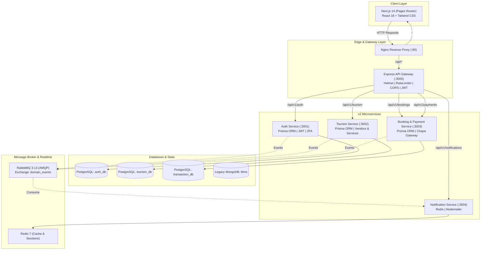

# Lake Tana Tourism Management System (LTTMS) — Project Audit & Architecture Report

**Date:** November 3, 2026  
**Auditor:** Antigravity AI Senior Architect & Systems Auditor  
**Repository:** `LTTMS`  
**Current Monorepo Version:** `2.0.0` (with legacy `v1.0.0` artifacts present)

---

## Executive Summary

The **Lake Tana Tourism Management System (LTTMS)** is an ambitious, domain-rich full-stack platform designed to power the eco-tourism economy of Lake Tana (Bahir Dar, Ethiopia). It connects **tourists**, local **vendors** (boat operators, monastery tours, eco-lodges, cultural guides), and platform **administrators**.

During this audit, the repository was found to be in the middle of a **major architectural transition from a v1 Two-Tier Monolith to a v2 Event-Driven Microservices Monorepo**.

```
┌────────────────────────────────────────────────────────────────────────┐
│                        CURRENT REPOSITORY STATE                        │
├───────────────────────────────────┬────────────────────────────────────┤
│         v1.0 (Legacy Monolith)     │       v2.0 (Target Architecture)   │
├───────────────────────────────────┼────────────────────────────────────┤
│ • Next.js 14 Frontend             │ • Next.js 14 Frontend              │
│ • Express.js Monolith (`backend/`)│ • Express API Gateway (:3000)      │
│ • MongoDB (Mongoose ODM)          │ • 4 Express Microservices (:3001-4)│
│ • In-memory cache & token store   │ • PostgreSQL + Prisma (3 DBs)      │
│ • Chapa Gateway with mock sandbox │ • RabbitMQ (Topic Event Bus)       │
│ • Deployed via render.yaml        │ • Redis (Cache/Rate-Limiting)      │
│ • CI via GitHub Actions           │ • Nginx Reverse Proxy (:80)        │
└───────────────────────────────────┴────────────────────────────────────┘
```

> [!CAUTION]
> **State of the Codebase:** The project currently exists in a **split state**. The v2 microservices (`services/*`, `packages/*`, `docker-compose.yml`, `docs/`) and frontend reconfiguration (`api.js` pointing to `:3000/api/v1`) were introduced without completing the integration. As a result:
> 1. The **frontend is broken when pointed to the v2 API Gateway** due to route path mismatches, auth response contract discrepancies, and MongoDB (`_id`) vs PostgreSQL (`id`) schema incompatibilities.
> 2. The **Docker Compose environment fails to build and run** due to Docker build context isolation preventing access to root `@lttms/*` workspace packages, missing lockfiles, and missing `JWT_SECRET` environment variables in child services.
> 3. The **v1 monolith is functional but decoupled**, and its test suite hangs due to unreferenced background timers.

---

## 1. System Architecture Analysis

### 1.1 Architecture Evolution & Topology



---

## 2. Directory & Component Audit

### 2.1 Workspace Root
- **`package.json`**: Configured as an npm workspace managing `packages/*`, `services/*`, and `apps/*`. Orchestration scripts include `npm run dev` (running all 5 backend microservices and frontend via `concurrently`), `docker:up`, and `db:migrate`.
- **`docker-compose.yml`**: Provisions 9 containers: `postgres` (PostgreSQL 16), `redis` (Redis 7), `rabbitmq` (RabbitMQ 3.13), `auth-service`, `tourism-service`, `booking-payment-service`, `notification-service`, `api-gateway`, and `frontend`.
- **`render.yaml`**: Out of sync. Configured only for the v1 monolith (`backend/` on port 5000 + `frontend/` on port 3000) pointing to MongoDB.
- **`.github/workflows/ci.yml`**: Out of sync. Only tests `backend` and builds `frontend`; ignores all 5 microservices and 5 packages.

---

### 2.2 Frontend (`frontend/`)
Built with **Next.js 14.2.21 (Pages Router)**, **React 18.2.0**, **TypeScript 5.3**, and **Tailwind CSS 3.3.6**.

#### Routes & Portals:
| Path | Target Role | Implementation Status & Notes |
|------|-------------|-------------------------------|
| `/` | Public | Complete, rich landing page with testimonials, destinations, and inline registration. |
| `/about`, `/eco-tourism`, `/history` | Public | High-quality educational content on Lake Tana, monasteries, and conservation. |
| `/services`, `/services/[id]` | Public / Tourist | Service filtering, category tabs, and search. Calls `API.get('/services')`. |
| `/booking/[id]` | Tourist | Booking creation form. Computes price on client. Submits to `/bookings`. |
| `/booking` | Tourist | Booking history & status tabs. Falls back to mock counts if empty. |
| `/vendors` | Public | Vendor directory. Calls `API.get('/vendors')`. |
| `/login`, `/register` | Public | Tourist / Vendor authentication forms. |
| `/admin/dashboard` | Admin | 9 dashboard tabs. Initialized with extensive mock data; attempts API sync. |
| `/vendor/dashboard` | Vendor | Service & booking management. Uses mock data fallbacks. |
| `/vendor/register`, `/vendor/login` | Vendor | Vendor auth wrappers. |

---

### 2.3 Services (`services/*`)

#### 1. `api-gateway` (Port 3000)
- **Role:** Central HTTP proxy, rate limiting, helmet, correlation ID generation, JWT verification, and basic RBAC.
- **Routing:**
  - `/api/v1/auth/*` $\rightarrow$ `auth-service:3001` (rewritten to `/api/auth/*`)
  - `/api/v1/tourism/*` $\rightarrow$ `tourism-service:3002` (rewritten to `/api/tourism/*`)
  - `/api/v1/bookings/*` $\rightarrow$ `booking-payment-service:3003` (rewritten to `/api/bookings/*`)
  - `/api/v1/payments/*` $\rightarrow$ `booking-payment-service:3003` (rewritten to `/api/payments/*`)
  - `/api/v1/notifications/*` $\rightarrow$ `notification-service:3004` (rewritten to `/api/notifications/*`)
  - `/api/v1/admin/*` $\rightarrow$ `auth-service:3001` (rewritten to `/api/admin/*`)
- **Strengths:** Structured logging via Pino, correlation ID tracking on proxy requests, clean health check probing all 4 downstream services.

#### 2. `auth-service` (Port 3001)
- **Database:** PostgreSQL (`auth_db`) via Prisma.
- **Models:** `User` (with roles: `tourist`, `vendor`, `admin`), `RefreshToken`.
- **Features:** Password hashing (bcrypt 12 rounds), JWT access + refresh tokens, email verification, password reset, 2FA (TOTP via `otplib`), login brute-force locking (5 attempts, 15m lockout), RabbitMQ event publication (`auth.user.registered`).

#### 3. `tourism-service` (Port 3002)
- **Database:** PostgreSQL (`tourism_db`) via Prisma.
- **Models:** `Vendor`, `Service`, `Category`, `Review`, `EcoBadge`, `VendorEcoBadge`.
- **Features:** Service search with pagination, category filter, price bounds, full-text search; vendor registration and profile updates; review submission with uniqueness constraints.

#### 4. `booking-payment-service` (Port 3003)
- **Database:** PostgreSQL (`transaction_db`) via Prisma.
- **Models:** `Booking`, `Payment`, `RefundRequest`, `CommissionTransaction`.
- **Features:** Booking creation, user booking queries, Chapa checkout initialization, Chapa transaction verification, payment webhook handling.

#### 5. `notification-service` (Port 3004)
- **Database:** Redis (in-app notifications store, unread counter).
- **Features:** AMQP event consumer listening to `domain_events` on RabbitMQ; sends transactional emails for `BookingConfirmed` and `VendorApproved`; maintains in-app notification state.

---

### 2.4 Shared Packages (`packages/*`)
- **`@lttms/logger`**: Standardized Pino logger and Pino HTTP middleware with request ID propagation.
- **`@lttms/messaging`**: Amqplib wrapper managing connection lifecycle, topic exchange assertion, event publishing, and queue subscriptions with standardized envelope schemas.
- **`@lttms/shared-config`**: Centralized environment variable accessor with default fallback values.
- **`@lttms/shared-types`**: TypeScript type declarations for users, vendors, services, bookings, and payments.
- **`@lttms/shared-validation`**: Zod validation schemas for registration, login, bookings, services, and reviews.

---

### 2.5 Legacy Monolith (`backend/`)
- Express.js monolith connecting to MongoDB via Mongoose.
- Full route set: `auth.js`, `services.js`, `bookings.js`, `vendors.js`, `reviews.js`, `messages.js`, `admin.js`, `uploads.js`, `payments.js`.
- Features built-in Chapa sandbox mode, daily capacity checks across bookings, vendor status moderation, and CSV export.

---

## 3. Comprehensive Vulnerability & Bug Audit Matrix

| # | Severity | Component | Issue Description | Impact |
|---|----------|-----------|-------------------|--------|
| **1** | **CRITICAL** | `services/booking-payment-service` | `bookingController.js` line 68 hardcodes `totalAmount = 0`. | All bookings are created with 0 total. Chapa payment gateway rejects amount 0. Bookings cannot be paid. |
| **2** | **CRITICAL** | `docker-compose.yml` & Services | `JWT_SECRET` is omitted from `tourism-service` and `booking-payment-service` env blocks. | Any call to protected routes (`POST /services`, `POST /bookings`, `/payments`) throws `JsonWebTokenError: secretOrPublicKey must have a value`. |
| **3** | **CRITICAL** | `docker-compose.yml` & Dockerfiles | Docker build contexts are set to `./services/<name>` with `RUN npm ci`. | Local `@lttms/*` packages cannot be resolved; `package-lock.json` is missing in services. Docker builds fail completely. |
| **4** | **CRITICAL** | `services/api-gateway` & `auth-service` | Gateway proxies `/api/v1/admin/*` to `auth-service`, which has no `/api/admin` routes mounted. | All admin operations (`/admin/vendors`, `/admin/bookings`, `/admin/stats`) return 404 Not Found. |
| **5** | **HIGH** | `frontend/context/AuthContext.tsx` | AuthContext expects `{ token, user }` from v1, but `auth-service` returns `{ data: { accessToken, refreshToken, user } }`. | `token` and `user` resolve to `undefined`. Auth state is corrupted; users cannot stay logged in. |
| **6** | **HIGH** | Frontend $\leftrightarrow$ Gateway Routing | Frontend pages call `/services`, `/vendors`, `/admin/*` instead of `/tourism/services`, `/tourism/vendors`. | All frontend data fetching fails with 404 when pointing to the v2 API Gateway. |
| **7** | **HIGH** | Data Model (`_id` vs `id`) | Frontend pages (`booking/[id].tsx`, etc.) send and verify `service._id`. Prisma uses `service.id` (UUID). | Booking submission validation fails with missing service ID; UI checks evaluate to falsy. |
| **8** | **HIGH** | `frontend/pages/booking/[id].tsx` | Booking page never calls `/payments/checkout`. | Tourists can never initiate digital payment (Chapa/Telebirr); booking is confirmed prematurely without payment. |
| **9** | **MEDIUM** | `backend/middleware/auth.js` | Unref'd `setInterval` on line 9 keeps Node event loop active indefinitely. | Unit tests and scripts requiring `auth.js` hang and never exit. |
| **10** | **MEDIUM** | `services/tourism-service/src/prisma/seed.js` | Vendor seed hardcodes `userId: 'vendor-user-id'` instead of actual Auth user UUID. | Seed vendor is disconnected from the auth user account; vendor login cannot find its business profile. |
| **11** | **MEDIUM** | Realtime / Socket.IO | `frontend/utils/socket.js` imports `socket.io-client` which is not in `package.json`. No server implementation exists. | Importing `socket.js` crashes frontend build; socket proxy in Nginx forwards to nonexistent endpoint. |
| **12** | **LOW** | Password Policy Mismatch | Frontend allows password length $\ge 6$; backend Zod schema requires $\ge 8$, uppercase, lowercase, number. | Users get unexpected registration errors; error message is lost due to response structure mismatch. |

---

## 4. Architectural Comparison: v1 Monolith vs. v2 Microservices

```
┌─────────────────────────┬───────────────────────────────┬──────────────────────────────┐
│ Dimension               │ v1 Monolith (backend/)        │ v2 Microservices (services/) │
├─────────────────────────┼───────────────────────────────┼──────────────────────────────┤
│ Architecture            │ Two-tier monolith             │ Event-driven microservices   │
│ Primary Database        │ MongoDB (Single shared DB)    │ 3x PostgreSQL (Database-per- │
│                         │                               │ service pattern)             │
│ Inter-Service Comm.     │ In-process function calls     │ RabbitMQ topic exchange      │
│ Transaction Integrity   │ Mongoose model transactions   │ Eventual consistency         │
│ Service Discovery       │ None (single express process) │ Static Docker service URLs   │
│ Authentication          │ Cookie + JWT                  │ Header Bearer JWT + Refresh  │
│ State Caching           │ In-memory NodeCache           │ Distributed Redis 7          │
│ Admin Management        │ Fully implemented in monolith │ Incomplete / Unrouted        │
│ Deployment Readiness    │ Ready for Render.com          │ Broken Docker build contexts │
└─────────────────────────┴───────────────────────────────┴──────────────────────────────┘
```

---

## 5. Security & Compliance Review

1. **Authentication & Secret Management:**
   - Default fallback secrets (`'change-this-to-a-random-64-char-string'`) exist in config files. In production, missing environment variables should throw a fatal error on startup rather than falling back to known static strings.
   - Access tokens have an appropriate 15-minute expiry (`15m`); refresh tokens have 30 days (`30d`) with database persistence.
2. **Authorization & RBAC:**
   - Both API Gateway and child services enforce role-based access (`tourist`, `vendor`, `admin`).
   - Downstream services verify JWTs independently, providing defence-in-depth even if gateway headers are spoofed.
3. **Rate Limiting & DoS Protection:**
   - API Gateway enforces 100 req/min globally and 20 req/min on auth endpoints (`/login`, `/register`, `/forgot-password`).
   - Nginx configuration specifies dual-zone request limiting with burst protection.
4. **Data Validation:**
   - Request payloads in v2 are validated using Zod (`@lttms/shared-validation`), preventing parameter pollution and malformed inputs.
5. **CORS & Headers:**
   - Helmet is configured across all services.
   - CORS origin validation checks against explicit allowed origins rather than wildcard in production.

---

## 6. Actionable Roadmap & Recommendations

### Phase 1: Fix Core Microservices & Docker Infrastructure (Immediate)
1. **Fix Docker Build Contexts:**
   Update `docker-compose.yml` to build from the monorepo root:
   ```yaml
   auth-service:
     build:
       context: .
       dockerfile: services/auth-service/Dockerfile
   ```
   Add root `package.json` and workspaces copy inside each Dockerfile, or generate workspace-aware Dockerfiles.
2. **Inject Missing Environment Variables:**
   Add `JWT_SECRET` to `tourism-service` and `booking-payment-service` in `docker-compose.yml`.
3. **Fix Booking Price Calculation:**
   In `booking-payment-service`, fetch the service price from `tourism-service` (or subscribe to service price cache events) to accurately calculate `totalAmount = service.price * guests`.
4. **Add Chapa Sandbox Fallback:**
   Port the sandbox checkout simulation from `backend/routes/payments.js` into `services/booking-payment-service/src/controllers/paymentController.js` for seamless development without live payment credentials.

### Phase 2: Gateway & Admin Routing Resolution
1. **Implement Aggregated Admin Gateway:**
   Route `/api/v1/admin/vendors` to `tourism-service`, `/api/v1/admin/bookings` to `booking-payment-service`, and `/api/v1/admin/users` to `auth-service`.
2. **Add Missing Admin Endpoints in Microservices:**
   Implement vendor status update (`PUT /status`) in `tourism-service` and booking override in `booking-payment-service`.

### Phase 3: Frontend Integration & Contract Harmonization
1. **Harmonize `AuthContext.tsx`:**
   Support both v1 and v2 payload shapes:
   ```typescript
   const token = res.data?.data?.accessToken || res.data?.token;
   const user = res.data?.data?.user || res.data?.user;
   ```
2. **Transition Frontend to `apiModules.js`:**
   Refactor frontend pages (`services.tsx`, `booking/[id].tsx`, `vendors.tsx`) to use the methods in `frontend/utils/apiModules.js` rather than direct raw path calls to legacy `/services`.
3. **Support Universal IDs (`id` and `_id`):**
   Update booking and detail pages:
   ```typescript
   const serviceId = service.id || service._id;
   ```
4. **Connect Chapa Payment in Booking Flow:**
   After creating a booking in `booking/[id].tsx`, call `POST /payments/checkout` and redirect to the returned `checkoutUrl`.

### Phase 4: CI/CD & Deployment Updates
1. **Update GitHub Actions (`.github/workflows/ci.yml`):**
   Add steps to test packages and services, run Prisma validations, and lint the monorepo.
2. **Modernize `render.yaml`:**
   Define services for PostgreSQL, Redis, RabbitMQ, and the containerized microservices stack.
